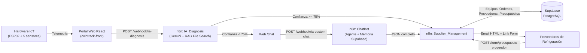
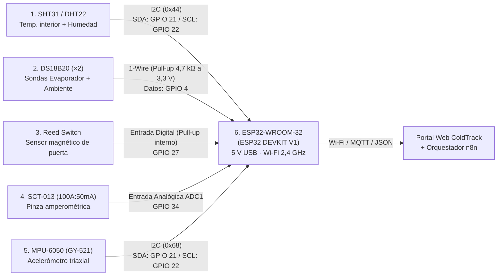

# Documentación Técnica y Funcional — ColdTrack

> **Fuente de verdad:** Este documento está basado directamente en el código de la aplicación web ([coldtrack-front](file:///d:/MiaCarpeta/4-Repos/5.Coldtrack-TFI-Admin/coldtrack-front)), los flujos productivos configurados en **n8n** (`IA_Diagnosis`, `ChatBot` y `Supplier_Management`) y la definición de negocio del proyecto **TucSoft / ColdTrack** (TP N°1 — Administración de Sistemas, UTN FRT).

---

## 1. ¿De qué va ColdTrack y cuál es su Modelo de Negocio?

**ColdTrack** (**ColdTrack IoT Pro**) es una plataforma tecnológica híbrida (**Hardware IoT + SaaS B2B + Inteligencia Artificial + Orquestación en n8n**) desarrollada por **TucSoft** para modernizar el monitoreo, diagnóstico y mantenimiento de equipos de frío comercial (visicoolers, heladeras exhibidoras y freezers).

### 1.1. Contexto de Mercado, Problema Operativo y Propuesta de Valor
En la industria de consumo masivo, bebidas, lácteos, helados, supermercadismo y estaciones de servicio (como las redes de embotelladoras estilo Arca Continental o distribuidoras regionales en el NOA), los equipos de frío entregados en **comodato** o instalados en puntos de venta constituyen un activo crítico: **si la heladera no enfría, el producto no rota, la marca pierde presencia y la mercadería perecedera se desperdicia**.

Sin embargo, la operación tradicional de mantenimiento de flotas de frío comercial sufre una desconexión estructural entre el activo físico, el comerciante depositario, la empresa dueña de la flota y los talleres tercerizados:

| Etapa del Ciclo | Modelo Tradicional Reactivo (Sin ColdTrack) | Modelo Predictivo e Hiperautomatizado (Con ColdTrack) |
| :--- | :--- | :--- |
| **1. Detección de la anomalía** | **Tardía y humana:** El comerciante nota las bebidas calientes o el equipo apagado horas o días después del inicio de la falla. | **Instantánea y continua (24/7):** El nodo `ESP32` detecta desviaciones térmicas, eléctricas o mecánicas antes del colapso total. |
| **2. Primer diagnóstico y filtro** | **Visita a ciegas:** Se envía un técnico al local sin saber qué falla tiene. Hasta un **85 %** de los reclamos resultan ser falsos positivos (puerta mal cerrada, mercadería tibia recién cargada, enchufe flojo). | **Doble filtro cognitivo (IA + Chatbot):** El agente RAG (`IA_Diagnosis`) cruza 15 métricas con manuales técnicos. Si hay ambigüedad (`< 75 %`), el `ChatBot` valida con el comercio en segundos y evita el despacho innecesario. |
| **3. Cotización y asignación** | **Burocrática y manual:** Llamadas, correos o mensajes de WhatsApp a proveedores, presupuestos heterogéneos y aprobación manual sin trazabilidad. | **Licitación digital geolocalizada:** `Supplier_Management` consulta en Supabase los talleres homologados de esa misma localidad y solicita cotizaciones estandarizadas por correo con ventana de 4 horas. |
| **4. Adjudicación y auditoría** | **Subjetiva y lenta:** Demoras administrativas que estiran la inactividad del activo hasta **5 días**, sin métricas objetivas de desempeño por proveedor. | **Algorítmica y auditable (< 4 horas):** Motor de scoring ponderado (**Precio 40 %**, **Tiempo 30 %**, **Reputación 30 %**) que adjudica automáticamente la orden y notifica al taller ganador. |

Cuatro indicadores resumen el impacto directo en el negocio ([Landing.jsx](file:///d:/MiaCarpeta/4-Repos/5.Coldtrack-TFI-Admin/coldtrack-front/src/pages/Landing.jsx)):
- **Tiempo de ciclo menor a 4 horas** (frente a los 5 días del esquema tradicional).
- **85,0 % de visitas técnicas innecesarias evitadas** gracias al filtro cognitivo y conversacional de falsos positivos.
- **0,5 % de tasa de error** en el diagnóstico predictivo mediante IA + RAG.
- **Escala de flota (+1.240 activos monitoreados)** desde un único panel operativo.

---

### 1.2. Propuesta de Valor Diferenciada por Actor (Modelo B2B Multi-Actor)

ColdTrack opera como una plataforma **B2B de tres puntas** que alinea los intereses económicos y operativos de todos los participantes del ecosistema:

1. **Para el Dueño de la Flota / Cliente Corporativo (Embotelladoras, Lácteas, Retail, Estaciones de Servicio):**
   - **Reducción directa de OPEX de mantenimiento:** Elimina el costo de viáticos y horas-hombre por visitas de diagnóstico o falsos positivos (`85 %` de ahorro en despachos improductivos).
   - **Extensión de la vida útil del activo (CAPEX):** Detecta tempranamente un compresor trabajando forzado (`450 min` continuos por fuga de gas en `REF-TUC-002`) o con rotor bloqueado (`16,5 A` en `REF-TUC-003`) antes de que se queme el bobinado completo.
   - **Transparencia y gobierno de proveedores:** Reemplaza la asignación discrecional por una licitación competitiva auditable en base de datos, con costos reales de referencia en pesos argentinos (ej. órdenes entre `$ 25.000,00` y `$ 92.000,00` en [ordersData.js](file:///d:/MiaCarpeta/4-Repos/5.Coldtrack-TFI-Admin/coldtrack-front/src/data/ordersData.js)).
   - **Protección de ventas e inocuidad:** Minimiza las horas con equipo fuera de rango térmico (`> 8 °C`), protegiendo el stock y las ventas en el punto de venta.
2. **Para el Punto de Venta / Comercio Depositario (Kioscos, Almacenes, Supermercados):**
   - **Cero carga técnica:** No necesita conocimientos de refrigeración ni llenar planillas; cuando el sistema requiere verificación visual, el **Agente Investigador (`/chat`)** le hace preguntas simples en lenguaje cotidiano.
   - **Seguridad eléctrica preventiva:** Si durante la conversación el comerciante reporta olor a quemado, chispas o humo, el asistente le indica de inmediato desconectar el equipo de la red eléctrica.
   - **Continuidad comercial y ahorro energético:** Un equipo con burletes sanos y condensador limpio consume menos energía eléctrica (`1,2 kWh/día` en estado óptimo vs. `3,8 kWh/día` con pérdida de estanqueidad) y mantiene las bebidas siempre a temperatura de venta (`3,2 °C`).
3. **Para la Red de Proveedores Técnicos Locales (Talleres de Refrigeración Homologados):**
   - **Órdenes pre-diagnosticadas con alta precisión:** El taller recibe en su correo el modelo del equipo, su ubicación exacta, el diagnóstico predictivo de la IA y el razonamiento técnico completo, lo que le permite **viajar en la primera visita con el repuesto, gas o herramienta exacta** (reparación en primera visita / *First-Time Fix*).
   - **Flujo constante de trabajo geolocalizado:** Solo recibe solicitudes de equipos ubicados en sus localidades de cobertura declaradas en `proveedores_localidades`.
   - **Reglas de juego claras y meritocráticas:** Los talleres con mejor cumplimiento histórico (`calificacion_historica` de 1 a 5 estrellas) y tiempos de respuesta competitivos ganan mayor volumen de órdenes gracias al peso del **60 % combinado entre Tiempo y Reputación** en el algoritmo de adjudicación.

---

### 1.3. Lean Business Model Canvas — ColdTrack IoT Pro

| Bloque del Modelo | Definición Estratégica en ColdTrack |
| :--- | :--- |
| **1. Segmentos de Clientes** | **• Clientes Primarios (Pagadores B2B):** Empresas con parques de `+100` a `+5.000` equipos de frío distribuidos (embotelladoras, cervecerías, lácteas, heladerías industriales, cadenas de supermercados y redes de estaciones de servicio).<br/>**• Usuarios Operativos:** Gerentes de mantenimiento/trade marketing, encargados de comercios depositarios y talleres técnicos regionales. |
| **2. Propuesta de Valor Única** | Transformar cualquier heladera comercial estándar en un **activo inteligente auto-diagnosticable** mediante un kit *retrofit* no invasivo, reduciendo el tiempo de resolución de fallas de **5 días a menos de 4 horas** y automatizando de punta a punta la licitación y asignación de técnicos. |
| **3. Canales de Distribución y Contacto** | **• Venta consultiva B2B directa** y pilotos sobre flotas regionales (NOA / Tucumán: San Miguel de Tucumán, Yerba Buena, Las Talitas, Alberdi).<br/>**• Portal Web SaaS (`coldtrack-front`)** con Dashboard operativo, Gemelos Digitales 3D y Chatbot.<br/>**• Canal B2B automatizado por correo y formularios web n8n** para la red de talleres proveedores. |
| **4. Relación con Clientes y Aliados** | **• Autoservicio asistido por IA:** Monitoreo continuo en Dashboard + asistente conversacional con memoria persistente por equipo en Supabase.<br/>**• Co-creación técnica:** La empresa cliente puede alimentar su propia base de conocimiento subiendo manuales `.pdf` o `.txt` al subflujo RAG de `IA_Diagnosis`. |
| **5. Fuentes de Ingresos** | Esquema de ingresos recurrentes y transaccionales en 3 capas (**HaaS / Kit Retrofit + Suscripción SaaS por activo + Fee / Gestión del Marketplace B2B**), detallado en la sección 1.4. |
| **6. Recursos Clave** | **• Hardware:** Nodo ColdTrack IP65 (`ESP32-WROOM-32` + 5 sensores calibrados).<br/>**• Activos Digitales e IA:** Base documental vectorial en Google File Search, agentes Gemini en n8n, base relacional y memoria de sesiones en Supabase, y motor gráfico 3D en React Three Fiber. |
| **7. Actividades Clave** | Ensamblaje e instalación *retrofit* de nodos IoT; calibración de umbrales y entrenamiento documental RAG; homologación de talleres locales de refrigeración; operación y monitoreo de la plataforma cloud. |
| **8. Socios y Alianzas Clave** | **• Red de talleres técnicos regionales** (ej. *Servicios Térmicos del Norte*, *Frío Express S.A.*, *Refrigeración Tucumán SRL*).<br/>**• Proveedores de infraestructura Cloud e IA:** Google Gemini API (LLM + File Search), Supabase (PostgreSQL), n8n (orquestación) y proveedores de componentes electrónicos. |
| **9. Estructura de Costos** | **• Costo de Hardware (BOM):** Placa `ESP32`, sensores (`SHT31`, `DS18B20 ×2`, `Reed Switch`, `SCT-013`, `MPU-6050`), gabinete IP65, borneras y prensacables.<br/>**• Infraestructura Cloud:** Consumo de tokens API Gemini, instancias de n8n, base de datos Supabase y hosting frontend.<br/>**• Operación e I+D:** Desarrollo de software/firmware, soporte y onboarding de flotas y proveedores. |

---

### 1.4. Esquema de Monetización, Pricing y Retorno de Inversión (ROI)

El modelo de ingresos de **TucSoft** con ColdTrack combina flujo de caja inicial (despliegue de hardware) con ingresos recurrentes de alto margen (ARR por suscripción SaaS y operación del marketplace):

1. **Línea 1 — Hardware IoT Retrofit (Venta Directa o *Hardware-as-a-Service*):**
   - **Kit ColdTrack Retrofit:** El nodo utiliza componentes industriales estándar de bajo costo relativo y alta disponibilidad (`ESP32`, `SCT-013`, `SHT31`, `DS18B20`, `MPU-6050`, `Reed Switch`) y se instala **sin cortar cables ni intervenir el circuito frigorífico** (manteniendo intacta la garantía original de la heladera).
   - **Modalidad CAPEX o OPEX:** El cliente corporativo puede adquirir los kits mediante un pago único inicial (*Setup + Instalación*) o integrarlos en un comodato tecnológico mensual (*HaaS*) junto con la licencia de software.
2. **Línea 2 — Suscripción SaaS Mensual por Activo Conectado (*Tiered SaaS*):**
   - **Tarifa recurrente por equipo/mes (`$/activo/mes`):** Escalonada según el tamaño de la flota monitoreada (`100`, `500`, `+1.240` equipos).
   - **Qué incluye:** Telemetría continua de 15 parámetros, acceso al Dashboard y Gemelos Digitales 3D (`/simulacion`), ejecución ilimitada de diagnósticos cognitivos RAG (`IA_Diagnosis`), atención automatizada 24/7 del `ChatBot` al comerciante y almacenamiento histórico en Supabase.
3. **Línea 3 — Orquestación B2B y Marketplace de Mantenimiento:**
   - **Ahorro por licitación competitiva:** Al licitar cada orden entre todos los talleres homologados de la localidad y ponderar el **40 % del puntaje por Precio** (sobre el tope de referencia de `$ 500.000,00` ARS), el sistema tracciona las cotizaciones hacia valores competitivos de mercado:
     - Mantenimiento preventivo y limpieza de condensador (`ORD-5190`): **`$ 25.000,00`**
     - Inspección de burletes y cierre magnético (`ORD-8104`): **`$ 31.000,00`**
     - Prueba de estanqueidad y recarga de gas R134a (`ORD-8492`): **`$ 48.500,00`**
     - Reparación crítica de compresor trabado y relé térmico (`ORD-7321`): **`$ 92.000,00`**
   - **Monetización del canal:** Permite aplicar un *fee* de gestión transaccional o membresía de homologación sobre la red de talleres adheridos, quienes a cambio reciben órdenes listas para ejecutar sin costo de adquisición comercial ni visitas de presupuesto perdidas.
4. **Ecuación de Retorno de Inversión (ROI) para el Cliente Corporativo:**
   - **Evitar una sola visita técnica innecesaria** (cuyo costo de desplazamiento y diagnóstico base en plaza ronda los `$ 25.000,00` a `$ 35.000,00` ARS) o **evitar la pérdida del stock de un solo freezer o exhibidora** amortiza varios meses de suscripción SaaS de ese nodo.
   - Con una reducción del **85 % en visitas por falsos positivos** y la prevención de quemado de motocompresores mediante detección temprana de sobrecorriente (`> 10 A`) o marcha continua (`450 min`), el sistema se autofinancia con el ahorro operativo generado en el propio presupuesto de mantenimiento.

---

### 1.5. Ciclo de Creación de Valor Extremo a Extremo (Hiperautomatización en 4 Etapas)

1. **Etapa 1 — Detección Proactiva en el Borde (Telemetría IoT):** El nodo `ESP32` instalado en la heladera captura 15 variables térmicas, eléctricas, mecánicas y operacionales en tiempo real.
2. **Etapa 2 — Diagnóstico Cognitivo Documental (`IA_Diagnosis` con RAG):**
   - Al detectar una anomalía, el agente `IA_Diagnosis` en n8n contrasta las 15 métricas del equipo contra manuales técnicos indexados vectorialmente en Google File Search.
   - Si la certeza es **alta (`>= 75 %`)**, habilita directamente la emisión de la orden de reparación sin intervención humana adicional.
   - Si la certeza es **baja (`< 75 %`)** o existe **contradicción de sensores** (ej. temperatura y humedad altas pero puerta reportada como cerrada en `REF-TUC-004`), el sistema bloquea el despacho prematuro de un técnico y activa la etapa conversacional.
3. **Etapa 3 — Investigación Conversacional Anti-Falsos Positivos (`ChatBot`):**
   - El **Agente Investigador** conversa en lenguaje simple con el encargado del local (manteniendo memoria en Supabase por `equipmentId`) para verificar si la puerta quedó obstruida, si el burlete está dañado o si hay un riesgo eléctrico, recolectando las respuestas antes de autorizar la orden.
4. **Etapa 4 — Licitación y Adjudicación Algorítmica (`Supplier_Management`):**
   - Confirmada la falla, n8n registra la orden en **Supabase**, identifica los proveedores de refrigeración habilitados en la misma localidad del equipo y les envía por correo una invitación a cotizar con plazo de **4 horas**.
   - Los talleres cargan costo en ARS, tiempo estimado en horas y notas técnicas en un formulario web.
   - Un proceso programado (`Cron` cada 30 min) evalúa las ofertas mediante la fórmula de scoring ponderado (**40 % Precio + 30 % Tiempo + 30 % Reputación**) y adjudica automáticamente el trabajo al proveedor ganador.

### Arquitectura general extremo a extremo



---

## 2. Qué ofrece la Plataforma Web (`coldtrack-front`)

La interfaz web está desarrollada con **React 19**, **Vite**, **Tailwind CSS v4**, componentes **Radix UI / shadcn**, íconos **Lucide React** y renderizado 3D con **Three.js / React Three Fiber** ([package.json](file:///d:/MiaCarpeta/4-Repos/5.Coldtrack-TFI-Admin/coldtrack-front/package.json)).

### Módulos y rutas ([App.jsx](file:///d:/MiaCarpeta/4-Repos/5.Coldtrack-TFI-Admin/coldtrack-front/src/App.jsx))

| Ruta | Página | Qué hace |
| :--- | :--- | :--- |
| `/` | [Landing.jsx](file:///d:/MiaCarpeta/4-Repos/5.Coldtrack-TFI-Admin/coldtrack-front/src/pages/Landing.jsx) | Presentación institucional, métricas de impacto (`4 Horas` de ciclo vs. `5 días`, `0.5%` tasa de error, `1,240+` activos, `85%` visitas evitadas), explicación del flujo de hiperautomatización en 3 fases y acceso al portal. |
| `/login` | [Login.jsx](file:///d:/MiaCarpeta/4-Repos/5.Coldtrack-TFI-Admin/coldtrack-front/src/pages/Login.jsx) | Inicio de sesión del portal (persistencia local en `localStorage` bajo `coldtrack_user` vía [AuthContext.jsx](file:///d:/MiaCarpeta/4-Repos/5.Coldtrack-TFI-Admin/coldtrack-front/src/context/AuthContext.jsx)) con resumen visual de los parámetros monitoreados. |
| `/dashboard` | [Dashboard.jsx](file:///d:/MiaCarpeta/4-Repos/5.Coldtrack-TFI-Admin/coldtrack-front/src/pages/Dashboard.jsx) | Panel operativo: 4 KPIs globales, filtros por ubicación/estado/búsqueda, tarjetas de equipos, gráfico SVG de temperatura de últimas 24 h (umbral de alerta en `8 °C`), modal de telemetría completa y modal de **Diagnóstico Cognitivo IA** conectado en vivo a n8n. |
| `/simulacion` y `/simulacion/:deviceId` | [Simulation.jsx](file:///d:/MiaCarpeta/4-Repos/5.Coldtrack-TFI-Admin/coldtrack-front/src/pages/Simulation.jsx) | Entorno con los **2 simuladores 3D interactivos** (equipo de frío + módulo sensor IoT) sincronizados con el equipo seleccionado. |
| `/chat` | [ChatBot.jsx](file:///d:/MiaCarpeta/4-Repos/5.Coldtrack-TFI-Admin/coldtrack-front/src/pages/ChatBot.jsx) | Asistente técnico conversacional conectado en vivo a n8n, con panel lateral de contexto del equipo ([ChatContextPanel.jsx](file:///d:/MiaCarpeta/4-Repos/5.Coldtrack-TFI-Admin/coldtrack-front/src/components/chat/ChatContextPanel.jsx)) y prompts sugeridos a partir de las preguntas del diagnóstico. |
| `/ordenes` | [Orders.jsx](file:///d:/MiaCarpeta/4-Repos/5.Coldtrack-TFI-Admin/coldtrack-front/src/pages/Orders.jsx) | Tablero de órdenes de reparación en vista de tabla y tarjetas, con KPIs, filtros por estado y prioridad, y modal de detalle ([OrderDetailModal.jsx](file:///d:/MiaCarpeta/4-Repos/5.Coldtrack-TFI-Admin/coldtrack-front/src/components/orders/OrderDetailModal.jsx)) para avanzar etapas y abrir la simulación 3D. |

### Equipos precargados y estado real vs. simulado en el frontend
- **Integración real con n8n:** Las llamadas desde el botón **"Diagnóstico IA"** (`runDiagnosis`), el botón **"Generar Orden de Reparación"** (`createRepairOrder`) y el chat (`/chat`, `sendChatToAgent`) ejecutan peticiones `fetch` reales (`POST` con `Basic Auth`) hacia los webhooks productivos configurados en [n8nService.js](file:///d:/MiaCarpeta/4-Repos/5.Coldtrack-TFI-Admin/coldtrack-front/src/services/n8nService.js).
- **Datos locales de demostración:** La flota mostrada en Dashboard, Simulación y Órdenes parte de conjuntos locales ([mockData.js](file:///d:/MiaCarpeta/4-Repos/5.Coldtrack-TFI-Admin/coldtrack-front/src/data/mockData.js) y [ordersData.js](file:///d:/MiaCarpeta/4-Repos/5.Coldtrack-TFI-Admin/coldtrack-front/src/data/ordersData.js)), mientras que las órdenes y presupuestos reales generados por n8n se persisten en **Supabase (PostgreSQL)**:
  - `REF-TUC-001` — *Visicooler 1 Puerta* (Kiosco El Paso - Yerba Buena): escenario **Normal** (`3,2 °C`, salud `98%`, `Operativo`).
  - `REF-TUC-002` — *Visicooler 500L* (Supermercado Norte - Las Talitas): escenario **Fuga de Gas** (`12,8 °C`, evaporador `24,5 °C`, `1,1 A`, `450 min` de marcha continua, salud `45%`, `Posible Falla`).
  - `REF-TUC-003` — *Freezer Horizontal* (Almacén Don Pepe - San Miguel de Tucumán): escenario **Compresor Trabado** (`9,5 °C`, `16,5 A`, FP `0,45`, vibración `1 Hz / 0 Hz`, salud `20%`, `Posible Falla`).
  - `REF-TUC-004` — *Heladera Doble* (Estación YPF - Alberdi): escenario **Falso Positivo / Contradicción** (`12,0 °C`, evaporador `-15,0 °C`, humedad `85%`, puerta `"closed"`, salud `88%`, `Posible Falla`).

---

## 3. ¿Qué hace nuestro Simulador y qué parámetros tiene?

La vista `/simulacion` ([Simulation.jsx](file:///d:/MiaCarpeta/4-Repos/5.Coldtrack-TFI-Admin/coldtrack-front/src/pages/Simulation.jsx)) renderiza **dos simuladores 3D interactivos** construidos de forma procedural con Three.js (`@react-three/fiber`, `@react-three/drei`, `@react-three/postprocessing` con oclusión ambiental `N8AO` y `Bloom`), además de admitir opcionalmente modelos `.glb` vía `modelUrl`.

### 3.1. Simulador 1: Gemelo Digital del Equipo de Frío (`EquipmentSimulator3D`)

Definido en [EquipmentSimulator3D.tsx](file:///d:/MiaCarpeta/4-Repos/5.Coldtrack-TFI-Admin/coldtrack-front/src/components/three/EquipmentSimulator3D.tsx), representa una heladera exhibidora comercial a escala (`0,80 m` de ancho × `0,72 m` de profundidad × `2,00 m` de alto) con gabinete, cabecera luminosa, puerta de doble vidrio con burlete magnético, rejilla inferior con controlador digital, estantes cromados, evaporador con forzador giratorio, sonda térmica, compresor hermético con cañerías de cobre, acelerómetro, pinza amperométrica, condensador con ventilador y caja IoT lateral.

#### Qué permite hacer
1. **Modo Rayos X:** Vuelve semitransparentes la carcasa exterior, el revestimiento interno y la rejilla (`opacity` interpolada a `0,09`) resaltando las aristas del gabinete para inspeccionar el interior sin desmontarlo.
2. **Vista Explotada (Despiece):** Desplaza suavemente cada subsistema (cabecera, puerta, estantes, evaporador, sonda, compresor, rejilla y módulo IoT) para analizar su ubicación y cableado.
3. **Hotspots numerados (1 al 5) y Panel de Telemetría:** Permite hacer clic sobre un punto del equipo o sobre una métrica del panel derecho para mover la cámara automáticamente hacia ese sensor/componente (activando Rayos X si no está en vista explotada).
4. **Reacción física y visual en tiempo real según telemetría:**
   - **Flujo de aire interno (280 partículas):** Circula en lazo cerrado en color celeste (`#7dd3fc`) cuando la puerta está cerrada. Si la puerta está abierta, gira sobre su bisagra (`1,85 rad`) y las partículas viran a ámbar (`#fbbf24`), escapándose por el frente.
   - **Estado del compresor:** Ante sobrecorriente y vibración alta, el compresor tiembla en alta frecuencia y se ilumina con un brillo rojo pulsante (`#ff2a1f`).
   - **Display digital y LEDs:** El display de la base cambia a rojo (`#ff5a4d`) si la temperatura supera `8 °C` (en lugar de turquesa `#5eead4`); el LED del sensor magnético de puerta vira a verde, ámbar o naranja según el diagnóstico.
5. **Selector de escenarios de prueba y Pantalla completa:** Permite cambiar al instante entre 4 escenarios preconfigurados y ampliar el visor a pantalla completa.

#### Los 6 parámetros del Simulador 3D (`EquipmentTelemetry`)
La función `toSimTelemetry(equipo)` en [Simulation.jsx](file:///d:/MiaCarpeta/4-Repos/5.Coldtrack-TFI-Admin/coldtrack-front/src/pages/Simulation.jsx) mapea la telemetría del equipo a **6 parámetros principales**:

| # | Parámetro (`EquipmentTelemetry`) | Tipo / Unidad | Origen en telemetría IoT | Umbral de alerta | Efecto visual / diagnóstico en el simulador |
| :-: | :--- | :--- | :--- | :--- | :--- |
| 1 | `temperatura` | `number` (°C) | `thermal.internal_temp_c` | `> 8 °C` | Display digital inferior en rojo y hotspot 1 (Sonda interior `SHT31`) en alerta. |
| 2 | `tempEvaporador` / `tempAmbiente` | `number` (°C) | `thermal.evaporator_temp_c` y `thermal.ambient_temp_c` | `tempEvaporador > 0 °C` | Hotspot 2 (Sondas `DS18B20`) en alerta naranja; permite diagnosticar **Fuga de Gas** cuando el evaporador pierde frío (`> 0 °C`) con temperatura interior `> 8 °C`. |
| 3 | `humedad` | `number` (%) | `thermal.humidity_pct` | `> 75 %` | Hotspot 3 (Evaporador y flujo de aire) en alerta; junto a `temperatura > 8` con puerta cerrada dispara contradicción. |
| 4 | `estadoPuerta` | `"abierta" \| "cerrada"` | `operational.door_status` (`"open"` / `"closed"`) | `"abierta"` | Abre la puerta 3D, las partículas de aire se vuelven ámbar y escapan por el frente; LED de sensor en ámbar. |
| 5 | `corriente` | `number` (A) | `electrical.compressor_amps` | `> 10 A` | Hotspot 5 (Pinza amperométrica) en alerta; combinado con vibración alta activa falla crítica de compresor. |
| 6 | `vibracion` | `"normal" \| "alta"` | `"alta"` si `compressor_amps > 10` o promedio `(vib_x + vib_y)/2 > 60 Hz` | `"alta"` | Hotspot 6 (Acelerómetro) en alerta; combinado con `corriente > 10` hace vibrar e iluminar en rojo el compresor. |

#### Reglas de diagnóstico local (`diagnose()`) y Escenarios predefinidos
El simulador evalúa localmente cuatro condiciones para mostrar alertas en el HUD y enviar `telemetryStatus` (`"ok"`, `"warning"`, `"error"`) al segundo visor 3D:
- **Compresor trabado (`error`):** `corriente > 10 && vibracion === "alta"` → *"Sobrecorriente con vibración alta. Cortar alimentación y revisar el compresor."*
- **Posible fuga de gas (`warning`):** `!doorOpen && !locked && !contradiction && tempEvaporador > 0 && temperatura > 8` → *"Sonda DS18B20 detecta evaporador sin frío (> 0 °C) con temperatura interior elevada."*
- **Puerta abierta (`warning`):** `estadoPuerta === "abierta"` → *"El aire frío se está escapando por el frente del gabinete."*
- **Verificación visual requerida / Contradicción (`warning`):** `!doorOpen && !locked && temperatura > 8 && humedad > 75` → *"Temperatura y humedad altas con la puerta informada como cerrada."*

Los **5 escenarios** seleccionables en la barra inferior del simulador son:

| Escenario | `temperatura` | `tempEvaporador` / `tempAmbiente` | `humedad` | `estadoPuerta` | `corriente` | `vibracion` | Estado resultante |
| :--- | :---: | :---: | :---: | :---: | :---: | :---: | :--- |
| **Óptimo** | `3,2 °C` | `-10,5 °C / 24,5 °C` | `45 %` | `"cerrada"` | `2,8 A` | `"normal"` | En rango (`ok`) |
| **Fuga de Gas** | `12,8 °C` | `24,5 °C / 26,0 °C` | `55 %` | `"cerrada"` | `1,1 A` | `"normal"` | Alerta fuga (`warning`) |
| **Puerta Abierta** | `9,5 °C` | `-6,0 °C / 25,0 °C` | `78 %` | `"abierta"` | `3,1 A` | `"normal"` | Alerta (`warning`) |
| **Compresor Trabado** | `11,2 °C` | `22,0 °C / 28,0 °C` | `60 %` | `"cerrada"` | `16,5 A` | `"alta"` | Falla crítica (`error`) |
| **Contradicción de Sensores** | `12,0 °C` | `-15,0 °C / 29,0 °C` | `85 %` | `"cerrada"` | `2,9 A` | `"normal"` | Alerta / Verificación (`warning`) |

---

### 3.2. Simulador 2 y Funcionamiento Detallado de los Sensores (`ColdTrackSensor3D`)

Definido en [ColdTrackSensor3D.tsx](file:///d:/MiaCarpeta/4-Repos/5.Coldtrack-TFI-Admin/coldtrack-front/src/components/three/ColdTrackSensor3D.tsx), modela el **nodo de hardware ColdTrack** alojado en un gabinete estanco **IP65** con **5 prensacables PG7**, 2 bloques de borneras verdes de 4 polos, cableado interno/externo, tapa removible (toggle **Abrir tapa / Despiece**) y un LED de estado sincronizado en tiempo real con el estado del primer simulador (`Operativo` en verde, `Con advertencias` en ámbar pulsante, `Con fallas` en rojo rápido).

#### Arquitectura electrónica y conexionado del nodo IoT



Al hacer clic en cada componente (en el modelo 3D, en sus callouts o en la barra inferior), la cámara hace zoom sobre la pieza y muestra su ficha técnica:

| # | Componente | Modelo | Bus / Interfaz | Conexión física al ESP32 | Qué mide | Falla que detecta |
| :-: | :--- | :--- | :--- | :--- | :--- | :--- |
| 1 | Sensor de temperatura y humedad | `SHT31 / DHT22` | Bus I2C | `SDA` en `GPIO 21`, `SCL` en `GPIO 22` (dirección `0x44`) | Temperatura interior (°C) y humedad relativa (%) | Pérdida de frío, ingreso de humedad o burletes dañados |
| 2 | Sondas de evaporador y ambiente | `DS18B20 (×2)` | Bus 1-Wire | Datos en `GPIO 4` con resistencia pull-up de `4,7 kΩ` a `3,3 V` | Temperatura de serpentina evaporadora (°C) y ambiente exterior (°C) | Fuga de gas refrigerante (evaporador `> 0 °C`) o bloqueo por hielo |
| 3 | Sensor magnético de puerta | `Reed Switch` | Entrada digital | `GPIO 27` como entrada digital con pull-up interno | Estado de la puerta (abierta o cerrada) y conteo de aperturas | Puerta abierta o mal cerrada por tiempo prolongado |
| 4 | Pinza amperométrica | `SCT-013` (`100A:50mA`) | Entrada analógica | `ADC1`: `GPIO 34`, con resistencia de carga y tensión de referencia | Corriente del compresor (A), sin cortar el cable de alimentación | Compresor trabado (sobrecorriente `> 10 A`) o que no arranca |
| 5 | Acelerómetro / vibración | `MPU-6050` (`GY-521`) | Bus I2C | `SDA` en `GPIO 21`, `SCL` en `GPIO 22` (dirección `0x68`) | Vibración del compresor en 3 ejes (`X`, `Y`, `Z` en Hz) | Desbalance mecánico, soportes flojos o compresor trabado |
| 6 | Microcontrolador | `ESP32-WROOM-32` (`DEVKIT V1`) | Wi-Fi 2,4 GHz | Alimentación `5 V` por USB; buses I2C, 1-Wire, ADC1 y GPIO | Concentra los parámetros del equipo y los transmite por Wi-Fi (MQTT) | Pérdida de conectividad o reinicios del nodo |

#### Funcionamiento físico y lógico de cada sensor en el equipo de frío

1. **Sonda interior de Temperatura y Humedad (`SHT31 / DHT22` — Cápsula sinterizada):**
   - **Ubicación física:** Interior superior del gabinete refrigerado (Hotspot 1 en el simulador de heladera).
   - **Principio de funcionamiento:** Posee un cartucho metálico sinterizado transpirable que protege el chip capacitivo de humedad y el termistor digital de la condensación directa. Comparte el bus `I2C` (`GPIO 21/22`) usando la dirección `0x44`.
   - **Variables generadas:** `thermal.internal_temp_c` (rango operativo normal: `2 °C` a `5 °C`; umbral crítico: `> 8 °C`) y `thermal.humidity_pct` (umbral de alerta: `> 75 %`).
2. **Doble sonda térmica waterproof (`DS18B20 ×2` — Acero inoxidable):**
   - **Ubicación física:** Una vaina fijada en contacto directo con los tubos de cobre de la serpentina evaporadora y otra en la parte exterior/trasera midiendo la sala o local comercial.
   - **Principio de funcionamiento:** Ambas sondas comparten un único hilo de datos digital mediante protocolo **1-Wire** en el `GPIO 4` (con pull-up de `4,7 kΩ` a `3,3 V`), identificándose cada una por su dirección ROM única de 64 bits.
   - **Variables generadas:** `thermal.evaporator_temp_c` (en operación normal trabaja bajo cero, ej. `-10,5 °C` a `-15 °C`; si sube a `> 0 °C` mientras el compresor marcha, revela falta de expansión por **fuga de gas refrigerante**) y `thermal.ambient_temp_c`.
3. **Sensor magnético de puerta (`Reed Switch` — Pares enfrentados):**
   - **Ubicación física:** El bloque cableado se fija en el marco superior del gabinete (cabecera) y el bloque con imán permanente en el borde superior de la puerta de vidrio (Hotspot 3).
   - **Principio de funcionamiento:** Contacto hermético normalmente abierto/cerrado accionado por campo magnético, conectado a `GPIO 27` con resistencia pull-up interna del `ESP32`. Cuando la puerta se abre, el imán se aleja, cambia el nivel lógico del pin y el microcontrolador registra tanto el estado instantáneo como el acumulado diario de aperturas.
   - **Variables generadas:** `operational.door_status` (`"open"` / `"closed"`) y `operational.door_open_count_24h`.
4. **Transformador de corriente no invasivo (`SCT-013-000` — `100 A : 50 mA`):**
   - **Ubicación física:** Abrazado alrededor del conductor de fase que alimenta el motocompresor en la sala de máquinas inferior (Hotspot 4).
   - **Principio de funcionamiento:** Núcleo partido de ferrita que mide por inducción electromagnética la corriente alterna sin necesidad de cortar ni pelar el cable eléctrico (instalación *retrofit* limpia). Su salida de corriente secundaria pasa por una resistencia de carga (*burden resistor*) y un divisor de tensión de referencia (offset a `1,65 V`) hacia el conversor analógico-digital `ADC1` (`GPIO 34`).
   - **Variables generadas:** `electrical.compressor_amps` (consumo normal: `~2,8 A`; fuga de gas sin carga: `~1,1 A`; rotor bloqueado / compresor trabado: pico `> 10 A`, ej. `16,5 A`), además de derivar `compressor_run_time_min`, `daily_energy_kwh`, `line_voltage_v` y `power_factor`.
5. **Acelerómetro y giroscopio MEMS triaxial (`MPU-6050` sobre módulo `GY-521`):**
   - **Ubicación física:** Adosado rígidamente sobre la carcasa superior del domo del motocompresor hermético (Hotspot 5).
   - **Principio de funcionamiento:** Mide aceleraciones dinámicas en los ejes `X`, `Y`, `Z` y transmite las muestras por el mismo bus `I2C` (`GPIO 21/22`) en la dirección `0x68`. El `ESP32` procesa la frecuencia dominante de vibración en `Hz`.
   - **Variables generadas:** `mechanical.compressor_vibration_x_hz` y `mechanical.compressor_vibration_y_hz` (marcha normal: `~45–50 Hz`; si hay sobrecorriente `> 10 A` acompañada de anomalía vibratoria o bloqueo mecánico `1 Hz / 0 Hz`, confirma un **compresor trabado**; si supera `> 60 Hz`, alerta por tacos antivibratorios vencidos o desbalance).
6. **Unidad Central de Procesamiento y Telemetría (`ESP32-WROOM-32` — `DEVKIT V1`):**
   - **Ubicación física:** Montada sobre separadores de bronce dentro del gabinete estanco IP65 fijado en el lateral exterior de la heladera.
   - **Principio de funcionamiento:** Alimentada con `5 V` vía USB (con regulador `AMS1117` a `3,3 V` en placa y puente `CP2102`), lee periódicamente los buses `I2C`, `1-Wire`, `ADC1` y `GPIO`, empaqueta el payload JSON con las 4 categorías de telemetría y lo transmite vía Wi-Fi `2,4 GHz` (`MQTT` / `HTTP`) hacia la plataforma ColdTrack.

#### Matriz de Correlación Multi-Sensor para Diagnóstico de Fallas

La potencia del sistema radica en que **ningún sensor se evalúa de forma aislada**; el motor de IA (`IA_Diagnosis`) cruza las lecturas de los 5 sensores para distinguir fallas reales de falsos positivos:

| Escenario / Diagnóstico | SHT31 (`internal_temp_c` / `humidity_pct`) | DS18B20 (`evaporator_temp_c`) | SCT-013 (`compressor_amps` / `run_time`) | MPU-6050 (`vibration_x/y_hz`) | Reed Switch (`door_status`) | Acción del Sistema ColdTrack |
| :--- | :--- | :--- | :--- | :--- | :--- | :--- |
| **1. Operación Óptima** (`REF-TUC-001`) | `3,2 °C` / `45 %` | `-10,5 °C` (enfriando bien) | `2,8 A` / `25 min` (ciclo normal) | `48–49 Hz` (normal) | `"closed"` | Estado **Operativo** (`98 %` salud). Sin acción. |
| **2. Fuga de Gas Refrigerante** (`REF-TUC-002`) | `12,8 °C` (`> 8 °C`) / `55 %` | `24,5 °C` (`> 0 °C`, sin expansión) | `1,1 A` (baja carga) / `450 min` (marcha continua) | `35–36 Hz` (bajo esfuerzo) | `"closed"` | Diagnóstico IA con **Alta Confianza (`>= 75 %`)** → **Licitación directa** en `Supplier_Management`. |
| **3. Compresor Trabado** (`REF-TUC-003`) | `9,5 °C` (`> 8 °C`) / `60 %` | `22,0 °C` (no refrigera) | `16,5 A` (`> 10 A`, rotor bloqueado, FP `0,45`) | `1 Hz / 0 Hz` (bloqueo / sacudida en arranque) | `"closed"` | Diagnóstico IA Crítico con **Alta Confianza (`> 90 %`)** → **Orden urgente** de reparación. |
| **4. Contradicción / Falso Positivo** (`REF-TUC-004`) | `12,0 °C` (`> 8 °C`) / `85 %` (`> 75 %`, aire húmedo exterior) | `-15,0 °C` (el circuito frigorífico enfría perfecto) | `2,9 A` / `180 min` (compresor sano) | `45–46 Hz` (normal) | `"closed"` (contradice la humedad/temp.) | **Confianza Baja (`<= 65 %`)** → Deriva al **Agente Investigador (`/chat`)** para validar con el comercio antes de enviar un técnico. |

---

### 3.3. Modelo Completo de Telemetría IoT (15 parámetros hacia el Dashboard y n8n)

Además de los 5 parámetros simplificados de la vista 3D, cada equipo en el portal ([mockData.js](file:///d:/MiaCarpeta/4-Repos/5.Coldtrack-TFI-Admin/coldtrack-front/src/data/mockData.js) y [TelemetryModal.jsx](file:///d:/MiaCarpeta/4-Repos/5.Coldtrack-TFI-Admin/coldtrack-front/src/components/modals/TelemetryModal.jsx)) posee **15 métricas agrupadas en 4 categorías**, que son las que se envían completas al workflow de diagnóstico de n8n:

| Categoría | Parámetro (JSON) | Etiqueta en Web | Unidad | Regla de alerta en Web |
| :--- | :--- | :--- | :---: | :--- |
| **Térmico (`thermal`)** | `internal_temp_c` | Temperatura interior | °C | `> 8` |
| | `evaporator_temp_c` | Temperatura del evaporador | °C | `> 0` |
| | `ambient_temp_c` | Temperatura ambiente | °C | — |
| | `humidity_pct` | Humedad relativa | % | `> 75` |
| **Eléctrico (`electrical`)** | `line_voltage_v` | Tensión de línea | V | `< 205` o `> 240` |
| | `compressor_amps` | Corriente del compresor | A | `> 10` |
| | `power_factor` | Factor de potencia | — | `< 0.7` |
| | `daily_energy_kwh` | Consumo diario | kWh | — |
| **Mecánico (`mechanical`)** | `compressor_vibration_x_hz` | Vibración eje X | Hz | — |
| | `compressor_vibration_y_hz` | Vibración eje Y | Hz | — |
| | `fan_rpm` | Velocidad del forzador | RPM | — |
| | `noise_level_db` | Nivel acústico | dB | — |
| **Operacional (`operational`)** | `door_status` | Estado de puerta | `"open" \| "closed"` | `=== "open"` |
| | `door_open_count_24h` | Aperturas en 24 h | — | — |
| | `compressor_run_time_min` | Tiempo de marcha | min | — |

---

## 4. ¿Cómo funciona nuestro n8n?

En la instancia de n8n existen **3 workflows activos** que conforman la capa de IA, conversación y gestión B2B de ColdTrack (además de un 4° workflow inactivo llamado `Test_Bueno`, que es una prueba independiente de bot en Telegram y no forma parte de ColdTrack). Todos los webhooks productivos están protegidos con **HTTP Basic Auth**.

---

### 4.1. Workflow 1: `IA_Diagnosis` — Base de Conocimiento RAG y Diagnóstico Cognitivo

Este workflow tiene **dos subflujos independientes** dentro del mismo lienzo:

#### A. Subflujo de Indexación Vectorial (RAG Setup)
Permite cargar manuales o guías técnicas (`.pdf` o `.txt`) en la base documental semántica de Google para usar **RAG (Retrieval Augmented Generation)**:
1. **`Upload Files` (Form Trigger):** Formulario web para subir un archivo `.pdf` o `.txt`.
2. **`Normalize Files` (Code JS):** Extrae metadatos (`filename`, `mimetype`, `size`) y normaliza el archivo binario bajo la clave `data`.
3. **`Create DataBase` (HTTP Request):** Crea un *File Search Store* en la API de Google (`POST /v1beta/fileSearchStores`, nombre `n8n_documents_store`).
4. **`Combine information` (Code JS):** Combina los datos del store recién creado con el archivo binario.
5. **`Upload File to DB` + `Import to Database`:** Sube el binario a Google Files API (`/upload/v1beta/files`) y lo importa al store (`:importFile`) con metadatos (`upload_date`, `source: "n8n-workflow"`).
6. **`Database Search`:** Ejecuta una consulta de prueba con `gemini-2.5-flash` usando `fileSearch` para validar la indexación.

#### B. Subflujo de Diagnóstico en Tiempo Real
Se dispara cuando el usuario presiona **"Diagnóstico IA"** en el Dashboard (`runDiagnosis` en [n8nService.js](file:///d:/MiaCarpeta/4-Repos/5.Coldtrack-TFI-Admin/coldtrack-front/src/services/n8nService.js)):
1. **`Webhook` (`POST /webhook/ia-diagnosis`, Basic Auth):** Recibe el JSON completo de `equipo.telemetry`.
2. **`Parsear a String` (Code JS):** Aplana recursivamente (`flatten`) todo el objeto JSON recibido en una sola cadena clave-valor (ej.: `thermal.internal_temp_c: 12; thermal.humidity_pct: 85; ...`).
3. **`Gemini RAG Agent` (LangChain Agent):**
   - **Modelo LLM:** `Google Gemini Chat Model` (`models/gemini-3.5-flash-lite`).
   - **Herramienta (`search_diagnostics`):** HTTP Request Tool que consulta `gemini-2.5-flash` con `fileSearch` sobre `fileSearchStores/n8ndocumentsstore-8p66zd9nt5pf` para buscar patrones de falla en la base de conocimiento.
   - **Reglas estrictas de puntuación de confianza en el System Prompt:**
     - **ALTA (`> 90%`):** Coincidencia total con la base técnica (ej. `Amps > 10A` + `Vibración alta` = Compresor trabado).
     - **MEDIA (`75–89%`):** Diagnóstico claro con algún parámetro levemente fuera de patrón.
     - **BAJA (`< 70%`) — Caso de Contradicción de Sensores:** Si los datos térmicos sugieren puerta abierta (temperatura y humedad altas) pero `door_status` marca `closed`, el agente tiene **prohibido** afirmar que el sensor falló o que el burlete está roto; su confianza **no debe superar el 65%** y debe solicitar verificación visual al cliente mediante preguntas concretas.
   - **`Structured Output Parser`:** Obliga a responder exclusivamente en JSON válido en español con la siguiente estructura:
     ```json
     {
       "primary_diagnosis": "Diagnóstico breve",
       "confidence_level": 100,
       "reasoning": "Razonamiento técnico",
       "questions_for_client": ["Pregunta 1", "Pregunta 2"]
     }
     ```
4. **Respuesta al frontend:** Al estar configurado en `responseMode: "lastNode"` (y con el nodo auxiliar `HTTP Request` hacia `response_diagnosis_ia` deshabilitado), devuelve directamente el resultado al `AnalysisModal.jsx`.
   - Si `confidence_level >= 75`, la web habilita **"Generar Orden de Reparación"**.
   - Si `confidence_level < 75`, la web habilita **"Consultar Agente Investigador"** y deriva a `/chat`.

---

### 4.2. Workflow 2: `ChatBot` — Agente Investigador Conversacional

Se dispara desde la pantalla `/chat` ([ChatBot.jsx](file:///d:/MiaCarpeta/4-Repos/5.Coldtrack-TFI-Admin/coldtrack-front/src/pages/ChatBot.jsx) mediante `sendChatToAgent`):

1. **`Webhook` (`POST /webhook/ia-custom-chat`, Basic Auth):** Recibe `{ message, context, timestamp }`, donde `context` incluye `equipmentId`, `diagnosis`, `reasoning`, `questions` y `telemetry`.
2. **`Agente Conversacional` (LangChain Agent):**
   - **Modelo:** `models/gemini-3.5-flash-lite`.
   - **Memoria persistente:** `Postgres Chat Memory` conectada a **Supabase** usando `context.equipmentId` como `sessionKey` (ventana de las últimas 10 interacciones). Esto permite mantener conversaciones separadas e independientes por equipo.
   - **Comportamiento:** Actúa como *"ColdTrack Assistant"*, saludando al usuario, traduciendo las preguntas técnicas de `context.questions` a lenguaje cotidiano (sin jerga técnica) y verificando condiciones de riesgo (si reporta chispas o fuego, indica desconectar inmediatamente).
   - **Criterio de cierre:** Cuando considera que recolectó todas las respuestas del cliente, responde **únicamente** un bloque JSON con `id_equipo`, `datos_primer_analisis` (`diagnostico`, `razonamiento`, `preguntas_hechas`) y `comentarios_cliente`.
3. **`Comprobar JSON` + `¿JSON Listo?`:** Limpia posibles bloques Markdown (`` ```json ``) y verifica si la salida comienza con `{`.
   - **Rama `false` (conversación en curso):** pasa a `Devolver respuesta` y retorna `{ output: "texto para el usuario" }` al chat web.
   - **Rama `true` (investigación completada):**
     1. **`ParsearJSON`:** Convierte la salida en objeto JSON.
     2. **`Solicitar diagnostico` y `Crear Orden`:** Ejecutan peticiones `POST` (Basic Auth) hacia el webhook de `Supplier_Management` (`/webhook/supplier-management`) para iniciar la gestión de reparación. *(Nota técnica de implementación actual: ambos nodos apuntan hoy al mismo endpoint `/webhook/supplier-management`; `Solicitar diagnostico` envía `device_id`, `diagnosis`, `reasoning`, `preguntas_para_clientes`, `respuestas_clientes`, y `Crear Orden` envía `idEquipo`, `diagnostico`, `razonamiento`, que son los campos que `Supplier_Management` espera).*
     3. **`Agente de Cierre de Conversación`:** Un segundo agente Gemini (`gemini-3.5-flash-lite`) conectado a `Postgres Chat Memory1` (misma `sessionKey` en Supabase) redacta la despedida natural al cliente explicando brevemente la falla y confirmando que el proveedor se pondrá en contacto.

---

### 4.3. Workflow 3: `Supplier_Management` — Licitación, Presupuestos y Adjudicación Automática

Es el corazón operativo B2B en **PostgreSQL (Supabase)** y **Gmail**, compuesto por **3 flujos** dentro del mismo workflow:

#### A. Creación de Orden y Solicitud de Cotizaciones (Webhook)
Se dispara desde el modal de análisis (`createRepairOrder`, cuando la IA tuvo confianza `>= 75%`) o desde el `ChatBot` al finalizar las preguntas:
1. **`Webhook` (`POST /webhook/supplier-management`, Basic Auth):** Recibe `{ idEquipo, diagnostico, razonamiento }`. Responde de inmediato `"Workflow got started."` y continúa en segundo plano.
2. **`Buscar Equipo` (Postgres):** Selecciona el equipo en `public.equipos` donde `numero_serie = idEquipo` (`limit: 1`).
3. **`Crear Orden` (Postgres):** Inserta una nueva fila en `public.ordenes` con `equipo_id`, `diagnostico_ia` y `razonamiento`.
4. **`Buscar Proveedores` (Postgres SQL):** Busca proveedores habilitados en la misma localidad del equipo y de especialidad `'Refrigeración'`:
   ```sql
   SELECT * FROM proveedores AS p
     JOIN proveedores_localidades AS pl ON p.id = pl.id_proveedor
   WHERE pl.localidad = '<Localidad del equipo>'
     AND p.especialidad = 'Refrigeración'
   ```
5. **`Enviar Solicitudes` (Gmail):** Envía un correo HTML con diseño corporativo a cada proveedor encontrado incluyendo:
   - ID de orden, número de serie, dirección y localidad del equipo.
   - Diagnóstico predictivo IA y razonamiento técnico.
   - Botón CTA al formulario de presupuestos con parámetros precargados en la URL:
     `.../form/presupuesto-proveedor?order_id=<id>&proveedor_id=<id_proveedor>`.
   - Aviso de plazo máximo de **4 horas** para cotizar.

#### B. Recepción de Presupuestos (Formulario Web n8n)
1. **`Recibir Presupuestos` (Form Trigger, path `presupuesto-proveedor`):** Formulario web público donde cada proveedor carga:
   - `Costo Total (ARS)` (numérico, requerido)
   - `Tiempo Estimado (Horas)` (numérico, requerido)
   - `Notas Técnicas / Observaciones` (texto libre)
   - Campos ocultos heredados de la URL: `order_id`, `proveedor_id`.
2. **`Guardar Presupuestos` (Postgres):** Inserta la oferta en `public.presupuestos` (`orden_id`, `proveedor_id`, `precio`, `tiempo_estimado_horas`, `detalles_tecnicos`).

#### C. Evaluación Periódica y Adjudicación Automática (Cron cada 30 min)
1. **`Schedule Trigger`:** Se ejecuta automáticamente **cada 30 minutos**.
2. **`Buscar Ordenes Creadas` (Postgres):** Consulta órdenes en estado `'CREADA'` cuya antigüedad cumpla la ventana de espera (`fecha_creacion < NOW() - INTERVAL '0 HOURS'` actualmente para pruebas; el comentario SQL indica `-- Cambiar a 4 HORAS para producción`).
3. **`Buscar Presupuestos Asociados` (Postgres):** Obtiene todos los presupuestos de la orden junto con `prov.calificacion_historica`.
4. **`Code in JavaScript` (Motor de Scoring Ponderado sobre 100 puntos):**
   Para cada presupuesto recibido calcula:
   - **Puntaje por Precio (40%):** usando un tope de referencia `PRECIO_MAX_REF = 500000` ARS:
     $$\text{scorePrecio} = \max\left(0,\ \frac{500000 - \text{precio}}{500000} \times 40\right)$$
   - **Puntaje por Tiempo de Respuesta (30%):** usando un tope de referencia `TIEMPO_MAX_REF = 72` horas:
     $$\text{scoreTiempo} = \max\left(0,\ \frac{72 - \text{tiempo\_estimado\_horas}}{72} \times 30\right)$$
   - **Puntaje por Reputación Histórica (30%):** sobre escala de 1 a 5 estrellas (default `3` si no hay dato):
     $$\text{scoreReputacion} = \frac{\text{calificacion\_proveedor}}{5} \times 30$$
   - Suma `puntajeTotal`, ordena de mayor a menor y selecciona al ganador (`evaluados[0]`).
5. **`Actualizar Estado Orden` (Postgres):** Actualiza `public.ordenes` estableciendo `estado = 'ASIGNADA'`, `id_proveedor_asignado` y `costo_final`.
6. **`Buscar Proveedor Ganador` + `Buscar Equipo1` + `Enviar Confirmación` (Gmail):** Envía al proveedor adjudicado el correo **"¡Licitación Adjudicada!"** con el número de orden, serie del equipo, falla diagnosticada, monto aprobado en ARS y tiempo comprometido en horas.

---

### 4.4. Tablas en Supabase y Variables de Entorno

**Tablas PostgreSQL en Supabase utilizadas por n8n:**
- `public.equipos` (`id`, `numero_serie`, `Dirección`, `Localidad`, etc.)
- `public.ordenes` (`id`, `equipo_id`, `fecha_creacion`, `diagnostico_ia`, `razonamiento`, `estado`, `id_proveedor_asignado`, `costo_final`)
- `public.proveedores` (`id`, `email`, `especialidad`, `calificacion_historica`)
- `public.proveedores_localidades` (`id_proveedor`, `localidad`)
- `public.presupuestos` (`id`, `orden_id`, `proveedor_id`, `fecha_recibido`, `precio`, `tiempo_estimado_horas`, `detalles_tecnicos`, `puntaje_calculado`)
- Tablas automáticas de memoria de chat de n8n/LangChain (`Postgres Chat Memory`).

**Variables de entorno requeridas en `coldtrack-front` ([.env.example](file:///d:/MiaCarpeta/4-Repos/5.Coldtrack-TFI-Admin/coldtrack-front/.env.example)):**
- `VITE_N8N_DIAGNOSIS_URL`: URL del webhook `ia-diagnosis`.
- `VITE_N8N_REPAIR_URL`: URL del webhook `supplier-management`.
- `VITE_N8N_CHAT_URL`: URL del webhook `ia-custom-chat`.
- `VITE_N8N_AUTH_USER` y `VITE_N8N_AUTH_PASSWORD`: credenciales Basic Auth compartidas con los nodos Webhook de n8n.
